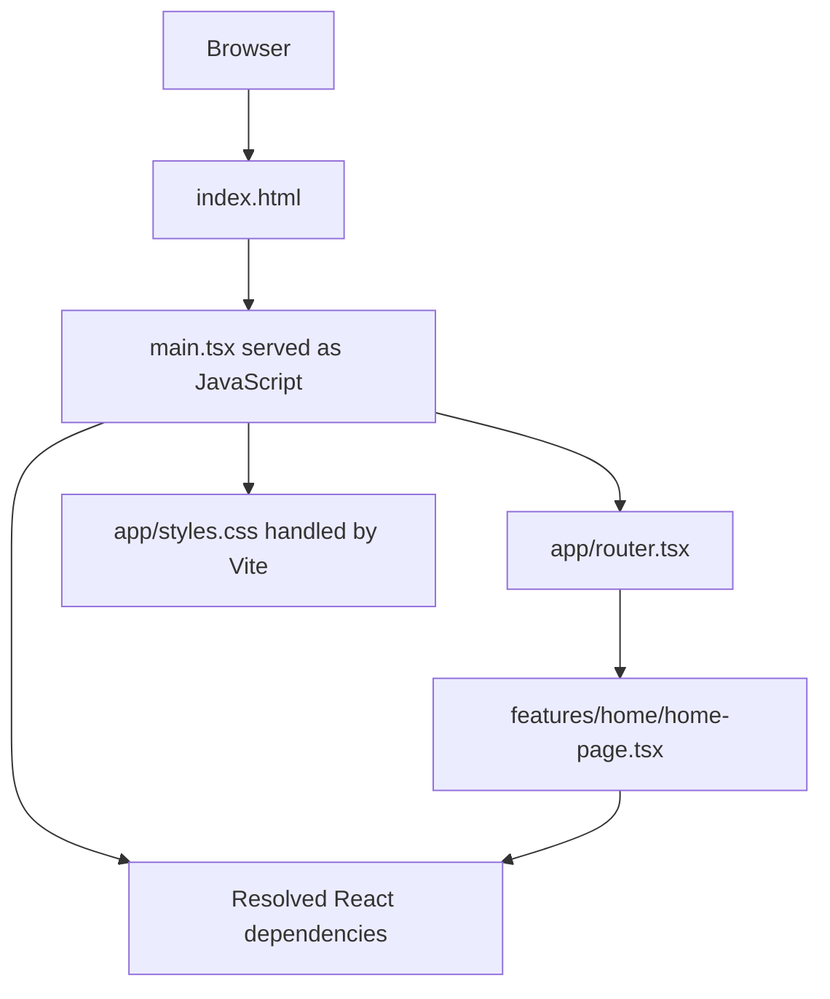

# Vite 8, Oxc, and Rolldown

## Contents

- [Introduction](#introduction)
- [How development and production differ](#how-development-and-production-differ)
- [Vite vs Webpack](#vite-vs-webpack)
- [Dependency optimization and caching](#dependency-optimization-and-caching)
- [HMR and React Fast Refresh](#hmr-and-react-fast-refresh)
- [Configuration in this project](#configuration-in-this-project)
- [Practical configuration examples](#practical-configuration-examples)
- [Complete combined configuration](#complete-combined-configuration)
- [1. Start development](#1-start-development)
- [2. Try TypeScript and JSX transformation](#2-try-typescript-and-jsx-transformation)
- [3. Build and preview](#3-build-and-preview)
- [4. Use CSS, assets, and public environment values](#4-use-css-assets-and-public-environment-values)
- [Best practices and common problems](#best-practices-and-common-problems)
- [Further reading](#further-reading)

## Introduction

Vite is the frontend build tool used to develop and build this React application.
Vite 8 integrates Oxc and Rolldown, so you use them through Vite's commands and
configuration. You do not need separate installations or configuration files for
these tools in this project.

| Tool | Responsibility |
| --- | --- |
| **Vite** | Runs the development server and coordinates the production build |
| **Oxc** | Transforms TypeScript and JSX into JavaScript |
| **Rolldown** | Follows module imports and bundles code into production chunks |

For example, when you build `src/features/home/home-page.tsx`, Oxc removes type annotations and
transforms JSX. Rolldown bundles the application modules and dependencies. Vite
coordinates these operations and writes the deployable HTML, JavaScript, CSS,
and other assets into `dist/`.

TypeScript type checking is separate from transformation. This project's build
script runs the TypeScript compiler before Vite, so type errors stop the build.
See the official [Vite 8 introduction](https://vite.dev/blog/announcing-vite8).

## How development and production differ

The article [Vite Explained From Zero: Why Vite Works Differently From Webpack](https://medium.com/@amitazadi/vite-explained-from-zero-why-vite-works-differently-from-webpack-16f6324a7624)
provides useful background for distinguishing development requests, dependency
preparation, and production output. The explanations below apply that distinction
to this repository and use the official Vite 8 documentation for tool behavior.

**Existing behavior.** This project's default development server uses native ES
modules (ESM): the browser follows `import` statements, and Vite serves transformed
application modules as they are requested. It still resolves imports, prepares
dependencies, and processes source; the browser does not execute raw TypeScript
or JSX. See [Why Vite](https://vite.dev/guide/why.html).

For this page, the request relationships look like this:



This is a simplified dependency graph, not a promise that requests run sequentially.
The browser and Vite can cache work and load modules concurrently. HTML contains
`<script type="module" src="/src/main.tsx"></script>`; its response is JavaScript
because Vite transforms the file before sending it.

**Existing behavior.** Production uses `pnpm build`, which checks types and then
runs Vite's build pipeline. Rolldown bundles modules; Vite writes HTML and optimized
assets into `dist/`. This reduces request overhead and enables optimizations such
as removing unused code where safe. A small app can have one main JavaScript chunk;
code splitting does not require every source file to become a separate output.
See [building for production](https://vite.dev/guide/build.html).

| Question | Development | Production build |
| --- | --- | --- |
| Command here | `pnpm dev` | `pnpm build` |
| Application source | Served as transformed modules on request | Bundled into generated assets |
| Dependencies | Optimized for development when needed | Included according to the production build graph |
| Main goal | Short feedback loop while editing | Deployable output for users |
| Output to deploy | None from the dev server | `dist/` |

A development server working successfully is not sufficient production validation.
Build and preview before deployment. Creating a project manually is covered in
[project-create.md](../project-create.md).

## Vite vs Webpack

This comparison is background for understanding the current setup; Webpack is not
installed in this project.

| Area | This Vite 8 setup | Typical Webpack setup |
| --- | --- | --- |
| Development delivery | Transformed source modules over native ESM, with optimized dependencies | Generated bundles built from the application's dependency graph |
| Source processing | Built-in handling and framework integration; Oxc transforms TS/JSX | Loaders process sources such as TS, JSX, and CSS according to configuration |
| Framework updates | React plugin integrates Fast Refresh | Framework integration and HMR can also be configured |
| Configuration here | React plugin plus explicit server, alias, optimizer, and build settings | Usually entry/output settings plus the relevant loaders and plugins |
| Production | Vite coordinates Rolldown and asset processing | Webpack builds and optimizes bundles |

Webpack supports caching, incremental compilation, and
[Hot Module Replacement](https://webpack.js.org/concepts/hot-module-replacement/);
it does not necessarily rebuild the entire application from scratch after every
edit. Actual startup and update speed depend on the project and configuration.
See [Webpack's concepts](https://webpack.js.org/concepts/) for its dependency graph,
loaders, and plugins.

Older Vite explanations may mention esbuild for development and Rollup for
production. For this project's Vite 8 pipeline, use Rolldown/Oxc terminology instead.
A familiar Rollup-style plugin API does not mean Rollup remains the underlying
bundler. See the [Vite 8 release notes](https://vite.dev/blog/announcing-vite8).

## Dependency optimization and caching

**Existing behavior.** Imports such as `import { useState } from 'react'` use a
bare package name. The browser does not resolve that name through `node_modules`
on its own. Vite resolves and rewrites imports into URLs it can serve.

Development pre-bundling converts dependencies that need browser-compatible module
handling and consolidates dependencies with many internal modules. Vite 8 uses
Rolldown for this dependency optimization. It does not require bundling all of
`src/` into one application file before serving the page.

Optimized dependencies are cached under `node_modules/.vite` by default. Lockfile
and relevant configuration changes help Vite decide when to regenerate them.
See [dependency pre-bundling](https://vite.dev/guide/dep-pre-bundling.html).

| Location | Contents | Managed by |
| --- | --- | --- |
| pnpm package store | Downloaded dependency files reused by installations | pnpm |
| `node_modules/.vite` | Development dependency optimization cache | Vite |
| `dist/` | Generated deployable application | Vite build |

**Optional troubleshooting command.** If a dependency update appears to leave stale
optimized output, stop the dev server and restart it with:

```sh
pnpm dev --force
```

This requests dependency re-optimization. It does not install missing packages or
fix type errors. This app explicitly includes React imports in its optimizer
configuration as part of the combined setup. Automatic discovery would normally
find them too; further `optimizeDeps.include` entries are useful when investigating
a concrete discovery or compatibility issue. `optimizeDeps` controls development optimization, not production
chunk sizes. See [dependency optimization options](https://vite.dev/config/dep-optimization-options.html).

## HMR and React Fast Refresh

**Existing behavior.** Hot Module Replacement (HMR) delivers updates while the
page stays open. Vite tracks affected modules and notifies its browser client.
The React plugin supplies Fast Refresh integration for eligible component changes.
It can preserve local state, though some edits require a remount or full reload.
Manual `import.meta.hot` handlers are unnecessary for these components; Vite's
[HMR API](https://vite.dev/guide/api-hmr.html) is primarily for tooling authors.

**Optional observation exercise:**

1. Run `pnpm dev` and open the Home diagram. Optionally mount the React guide's counter exercise first if you want to observe state preservation.
2. Change only a heading's text in `src/features/home/home-page.tsx` and save.
3. Check that the heading updates without a full reload. If the optional counter
   is mounted, check whether its state survives; structural edits may reset it.
4. Change a color in `src/app/styles.css` and save to observe the style update.
5. Open developer tools → Network to inspect the update requests and development
   WebSocket connection. Exact URLs and timestamps are implementation details.

Reloading resets an optional counter's local state. Appearance and sidebar
preferences are separately persisted in local storage.
Do not rely on Fast Refresh as storage. For React-specific refresh boundaries, see
[the React plugin documentation](https://github.com/vitejs/vite-plugin-react/tree/main/packages/plugin-react).

## Configuration in this project

Tailwind CSS 4 adds `@tailwindcss/vite` beside the React plugin. Oxc still
transforms application JS/TS and Rolldown bundles production output. TanStack
Router uses code-based routes and needs no additional Vite plugin.


Vite is pinned to **8.3.5** and `@vitejs/plugin-react` to **6.1.2** in
[package.json](../../package.json). Oxc and Rolldown are supplied by the Vite
pipeline, with resolved dependencies recorded in [pnpm-lock.yaml](../../pnpm-lock.yaml).

[vite.config.ts](../../vite.config.ts) contains:

```ts
import { fileURLToPath } from 'node:url';
import tailwindcss from '@tailwindcss/vite';
import react from '@vitejs/plugin-react';
import { defineConfig } from 'vite';

export default defineConfig({
  base: '/lab/react/v2/',
  plugins: [react(), tailwindcss()],
  server: {
    host: '127.0.0.1',
    port: 5174,
    strictPort: true,
    open: true,
  },
  resolve: {
    alias: {
      '@': fileURLToPath(new URL('./src', import.meta.url)),
    },
  },
  optimizeDeps: {
    include: ['react', 'react-dom/client'],
  },
  build: {
    outDir: 'dist',
    assetsDir: 'assets',
    sourcemap: true,
  },
});
```

`defineConfig` provides configuration typing. The React plugin enables React
integration, including Fast Refresh for development. Vite 8's default pipeline
already handles Oxc transformation and Rolldown bundling.


### Read configuration by responsibility

| Configuration | Responsibility | Use here |
| --- | --- | --- |
| `plugins` | Framework integration and build extensions | Existing `react()` plugin |
| `server` | Development host, port, and related behavior | Loopback port 5174, strict port, automatic opening |
| `resolve` | Import resolution, including aliases | `@` maps to `src/`, used by the app entry |
| `optimizeDeps` | Development dependency preparation | Explicit `react` and `react-dom/client` inclusion |
| `build` | Production output and optimization | `dist/assets/` output with source maps enabled |
| `base` | Public URL prefix used for serving generated assets | `/lab/react/v2/` for this project's hosting context |

These rows explain the active configuration and where a future change belongs.
A Webpack loader or plugin cannot simply be pasted into Vite's plugin array. Preserve the existing React plugin and add configuration only for a concrete
requirement. See [Vite configuration](https://vite.dev/config/).

## Practical configuration examples

**Focused explanations.** The project now uses the complete combined configuration
below. These smaller examples explain each part separately. When changing one
part, preserve the other active properties rather than replacing the whole file
with a reduced example. Keep one `defineConfig` object and one default export.

| Configuration | Useful when | Recommendation for this project |
| --- | --- | --- |
| `server` | A stable local URL or automatic browser opening helps your workflow | Active: loopback port 5174, strict port, automatic opening |
| `resolve.alias` | Nested components accumulate long relative imports | Active: `@/` maps to `src/` in Vite and TypeScript |
| `optimizeDeps` | A dependency needs explicit discovery or pre-bundling | Active: explicit React imports; automatic discovery normally finds them too |
| `build` | Hosting conventions or production debugging require different output | Active: `dist/assets/` output with production source maps |

### server: choose a predictable development URL

In `vite.config.ts`:

```ts
import tailwindcss from '@tailwindcss/vite';
import react from '@vitejs/plugin-react';
import { defineConfig } from 'vite';

export default defineConfig({
  base: '/lab/react/v2/',
  plugins: [react(), tailwindcss()],
  server: {
    host: '127.0.0.1',
    port: 5174,
    strictPort: true,
    open: true,
  },
});
```

Run `pnpm dev`. Expect the server at `http://127.0.0.1:5174/lab/react/v2/` and, where supported,
a browser window opening automatically. `strictPort` reports an error instead of
silently choosing another port when 5174 is occupied. This is useful for a fixed
bookmark or another local tool expecting that URL. Set `open: false` if you prefer
to open the page yourself.

This example listens on your computer's loopback address. For an occasional phone
layout check on the same network, `pnpm dev --host 0.0.0.0` listens on network
interfaces; open the computer's reachable LAN IP and dev port on the phone.
Use this only when network access is intended; connectivity also depends on local
network and firewall settings.

These are development settings. Use `preview` settings or preview CLI flags when
you need a specific preview address; `server.port` does not configure production
hosting. See [server options](https://vite.dev/config/server-options.html).

### resolve.alias: use @ for the source directory

In `vite.config.ts`:

```ts
import { fileURLToPath } from 'node:url';
import tailwindcss from '@tailwindcss/vite';
import react from '@vitejs/plugin-react';
import { defineConfig } from 'vite';

export default defineConfig({
  base: '/lab/react/v2/',
  plugins: [react(), tailwindcss()],
  resolve: {
    alias: {
      '@': fileURLToPath(new URL('./src', import.meta.url)),
    },
  },
});
```

The alias maps `@` to an absolute filesystem path. `import.meta.url` makes this
work with the project's ES module configuration. See
[Vite alias resolution](https://vite.dev/config/shared-options.html#resolve-alias).

The matching `paths` entry is already present inside `compilerOptions` in
`tsconfig.json`:

```json
{
  "paths": {
    "@/*": ["./src/*"]
  }
}
```

This is a property excerpt, not a replacement for the whole configuration. Preserve
all existing options and `include`. No `baseUrl` is needed: these paths are relative
to this project's `tsconfig.json`.

The project's `src/main.tsx` now demonstrates this alias:

```tsx
import HomePage from '@/features/home/home-page';
```

Restart development, run `pnpm check`, `pnpm typecheck`, and `pnpm build`,
and open the app. Expect
the same page. Vite resolves the runtime import, and TypeScript's `paths` supports
checking and editor navigation. TypeScript `paths` alone does not rewrite runtime
imports, so keep both mappings consistent. See [TypeScript paths](https://www.typescriptlang.org/tsconfig/paths.html).

The entry now uses `@/features/home/home-page`; a short relative import would also be readable.
An alias becomes more useful for deeper components that otherwise import through
several parent directories. It changes resolution, not file locations or package
installation.

### optimizeDeps: explicitly prepare a dependency

This focused excerpt shows the optimizer settings already enabled in the combined
configuration; retain the other active settings when editing:

```ts
import { fileURLToPath } from 'node:url';
import tailwindcss from '@tailwindcss/vite';
import react from '@vitejs/plugin-react';
import { defineConfig } from 'vite';

export default defineConfig({
  base: '/lab/react/v2/',
  plugins: [react(), tailwindcss()],
  server: {
    host: '127.0.0.1',
    port: 5174,
    strictPort: true,
    open: true,
  },
  resolve: {
    alias: {
      '@': fileURLToPath(new URL('./src', import.meta.url)),
    },
  },
  optimizeDeps: {
    include: ['react', 'react-dom/client'],
  },
  build: {
    outDir: 'dist',
    assetsDir: 'assets',
    sourcemap: true,
  },
});
```

Restart with `pnpm dev --force`, open the page, and inspect dependency requests in
browser developer tools. The page should behave the same. These two imports are
already discoverable in this app, so the explicit list is redundant but intentionally
retained in the active combined setup.

In a future integration, `include` is useful when automatic discovery misses a
package import introduced by a plugin, or a linked dependency needs pre-bundling.
Add an actual installed package/import path only when it is involved in a
specific issue. This setting does not install packages.

Keep automatic discovery enabled alongside the current explicit entries. Avoid adding dependencies to
`exclude` as a general speed tweak, especially CommonJS packages that need
conversion. `optimizeDeps` affects development; use build options to address
production output. See [optimizer options](https://vite.dev/config/dep-optimization-options.html)
and [dependency discovery](https://vite.dev/guide/dep-pre-bundling.html).

### build: make output explicit and generate source maps

The active build settings are shown in isolation below. Keep the alias and other
properties from the complete configuration when editing:

```ts
import tailwindcss from '@tailwindcss/vite';
import react from '@vitejs/plugin-react';
import { defineConfig } from 'vite';

export default defineConfig({
  base: '/lab/react/v2/',
  plugins: [react(), tailwindcss()],
  build: {
    outDir: 'dist',
    assetsDir: 'assets',
    sourcemap: true,
  },
});
```

Run `pnpm build`, then `pnpm preview`. Expect `dist/index.html`, generated JS/CSS
under `dist/assets/`, and JavaScript `.map` files. Browser developer tools can use
these maps to associate bundled code with source. `outDir` and `assetsDir` simply
make the existing defaults explicit; `sourcemap: true` changes the normal default
of not emitting production source maps. See [build options](https://vite.dev/config/build-options.html).

Production source maps are currently enabled. They help investigate built-app
problems and can expose source content when served. If deployment requirements
call for disabling them, change `sourcemap` deliberately and update the setup
documentation. Development debugging does not require this production option.

Keep `dist` unless hosting needs another directory. If changing `outDir`, also
update `.gitignore`, deployment commands, and documentation. `base` controls URL
prefixes and is separate from output directories. Prefer normal chunking and
browser targets until measurements or browser-support requirements justify changes.
See [production build guidance](https://vite.dev/guide/build.html).

### Validate only the options you adopt

After each intended configuration change:

```sh
pnpm check
pnpm typecheck
pnpm build
```

Restart development to verify the relevant behavior, then use preview for built
output. Build-configuration typing is checked by `tsconfig.node.json`. Keep source
imports and TypeScript mappings aligned. All four areas are already configured;
change only the settings needed for the task.

## Complete combined configuration

**Applied project configuration.** The project uses this complete configuration.
It combines all four areas and the `/lab/react/v2/` base path in one file, including explicit React dependency
optimization and production source maps. The table explains when these settings
are useful and which can be simplified later.

### 1. Complete vite.config.ts

Use this as a single `vite.config.ts`, replacing the earlier independent examples
rather than appending another default export:

```ts
import { fileURLToPath } from 'node:url';
import tailwindcss from '@tailwindcss/vite';
import react from '@vitejs/plugin-react';
import { defineConfig } from 'vite';
import { appearanceHeadScript } from './build/appearance-head.ts';
import menuConfig from './src/features/navigation/config/menu.json' with { type: 'json' };
import { parseMenu } from './src/features/navigation/model/menu-schema.ts';

parseMenu(menuConfig);

export default defineConfig({
  base: '/lab/react/v2/',
  plugins: [
    react(),
    tailwindcss(),
    {
      name: 'appearance-before-paint',
      transformIndexHtml() {
        return [{ tag: 'script', children: appearanceHeadScript(), injectTo: 'head-prepend' }];
      },
    },
  ],
  server: {
    host: '127.0.0.1',
    port: 5174,
    strictPort: true,
    open: true,
  },
  resolve: {
    alias: {
      '@': fileURLToPath(new URL('./src', import.meta.url)),
    },
  },
  optimizeDeps: {
    include: ['react', 'react-dom/client'],
  },
  build: {
    outDir: 'dist',
    assetsDir: 'assets',
    sourcemap: true,
    rolldownOptions: {
      output: {
        codeSplitting: {
          groups: [{ name: 'react-vendor', test: /\/node_modules\/(react|react-dom|scheduler)\// }],
        },
      },
    },
  },
});
```

| Part | What this example does | When to retain it |
| --- | --- | --- |
| `plugins` | Preserves React integration and Fast Refresh | Keep for this React application |
| `server` | Uses loopback port 5174, fails if occupied, and opens the browser | When a predictable local URL and automatic opening help |
| `resolve.alias` | Resolves `@/…` imports to the absolute `src/` directory | When aliases improve readability in nested components |
| `optimizeDeps` | Explicitly includes the installed React imports during development | Only for an actual optimizer issue; these entries are redundant in the current app |
| `build` | Writes normal `dist/assets/` output and adds production source maps | Retain the output paths; use source maps when production debugging calls for them |

`server` and `optimizeDeps` apply to development. `build` controls production
output. The alias participates in both development and building. No extra Oxc or
Rolldown package/configuration is required. The configuration preserves their
integration through Vite 8.

### 2. Hosting context and home navigation

The current app uses TanStack `Link to="/"` for home navigation and sets router
`basepath: import.meta.env.BASE_URL`. The plain-anchor example below remains
useful for a full-page navigation. Use [typed router links](tanstack-router.md)
for internal navigation. Configure host fallback to `/lab/react/v2/index.html`
for direct route requests such as `/lab/react/v2/about`.


The top-level `base: '/lab/react/v2/'` sets the public URL prefix during development,
preview, and build. Keep the trailing slash. It is independent of `server.port`
and `build.outDir`: generated files still go into `dist/`, and the host must map
that directory's contents to `/lab/react/v2/`.

For a full-page navigation, this optional native-anchor fragment is equivalent:

```tsx
<a className="brand" href={import.meta.env.BASE_URL} aria-label="GJP Lab home">
  GJP<span> / </span>LAB
</a>
```

The configured base becomes `/lab/react/v2/` in this expression. This prevents the home
link from navigating to the host's root. Vite rewrites processed HTML asset URLs,
including the existing favicon reference, and generated JS/CSS URLs to use the base.
For asset URLs constructed inside React, use `import.meta.env.BASE_URL` as shown
in the asset example below. TanStack routing is configured separately in `src/app/router.tsx`.

### 3. Complete matching tsconfig.json

This is the application configuration, including the active matching `paths` entry:

```json
{
  "compilerOptions": {
    "target": "ES2022",
    "lib": ["ES2022", "DOM", "DOM.Iterable"],
    "module": "ESNext",
    "moduleResolution": "Bundler",
    "jsx": "react-jsx",
    "types": ["vite/client"],
    "strict": true,
    "noUnusedLocals": true,
    "noUnusedParameters": true,
    "noFallthroughCasesInSwitch": true,
    "noUncheckedIndexedAccess": true,
    "exactOptionalPropertyTypes": true,
    "verbatimModuleSyntax": true,
    "isolatedModules": true,
    "noEmit": true,
    "allowImportingTsExtensions": true,
    "skipLibCheck": true,
    "paths": {
      "@/*": ["./src/*"]
    }
  },
  "include": ["src"],
  "exclude": ["src/**/__tests__/**"]
}
```

`"@/*": ["./src/*"]` tells TypeScript and the editor where `@/features/home/home-page` is located.
The mapping is relative to `tsconfig.json`, so no `baseUrl` is required. Vite's
`resolve.alias` handles runtime/build resolution; TypeScript's `paths` handles
checking. Keep both mappings pointed at the same directory.

All existing strict settings, browser libraries, JSX handling, and `include`
remain in place. `noEmit` keeps output generation with Vite.

### 4. Keep Node configuration checking enabled

The existing `tsconfig.node.json` works unchanged with the combined example:

```json
{
  "extends": "./tsconfig.json",
  "compilerOptions": {
    "lib": ["ES2022"],
    "types": ["node"]
  },
  "include": ["vite.config.ts"]
}
```

It checks `vite.config.ts` with Node types, including the `node:url` import. The
application configuration covers browser source; the Node configuration covers
build-tool code. The existing `pnpm typecheck` script checks application, Vite configuration,
and TypeScript tests. No changes to
`package.json` or installed dependencies are needed for this example.

### 5. Use and verify the alias

The browser entry imports the router and provider through the source alias:

```tsx
import { router } from '@/app/router';
import { AppearanceProvider } from '@/features/appearance/components/appearance-provider';
```

The route tree imports Home from `@/features/home/home-page`.

The rest of the entry remains intact. Verify the configuration with:

```sh
pnpm typecheck
pnpm dev --force
```

Expect the same page at `http://127.0.0.1:5174/lab/react/v2/`. The server opens a browser where
supported and refuses to switch ports if 5174 is busy. `--force` requests a fresh
optimizer pass for this exercise; it is not needed on every development run.
Check the diagram, navigation, and dependency requests in browser developer tools.

Stop development with Ctrl+C, then run:

```sh
pnpm build
pnpm preview
```

Expect type checking to pass, `dist/index.html` and its JS/CSS assets to be written,
and JavaScript `.map` files to appear in `dist/assets/`. Preview uses its own URL,
normally `http://localhost:4173/lab/react/v2/`, rather than the development port configured above.
Stop preview with Ctrl+C when finished.

The explicit React optimizer entries, production source maps, and browser opening
are part of the agreed project configuration. They are not required by every Vite
application. If a future task changes them, keep this guide, the README, and the
creation guide consistent. Removing the alias also requires restoring relative
imports and updating the TypeScript path mapping.

## 1. Start development

Run these commands from the project root with Node.js 24 or newer and pnpm 12 or newer installed:

```sh
pnpm install --frozen-lockfile
pnpm dev
```

Open the URL printed in the terminal, `http://127.0.0.1:5174/lab/react/v2/` for this configuration.
Vite loads [index.html](../../index.html), which imports
[src/main.tsx](../../src/main.tsx) and mounts the React application.

Change the heading in `src/features/home/home-page.tsx` and save. The browser should update. Fast
Refresh can preserve component state for simple edits, but some changes require
a remount or reload. Stop the server with Ctrl+C.

If you need a specific port:

```sh
pnpm dev --port 5175 --strictPort
```

This temporarily uses port 5175, with the same `/lab/react/v2/` base path, or
reports an error if that port is occupied.

## 2. Try TypeScript and JSX transformation

This is an optional exercise; the example component is not part of the base app.
Create `src/features/home/components/Welcome.tsx`, creating the directory if needed:

```tsx
type WelcomeProps = {
  name: string;
};

export default function Welcome({ name }: WelcomeProps) {
  return <p>Welcome to {name}!</p>;
}
```

Add this import at the top of `src/features/home/home-page.tsx`:

```tsx
import Welcome from './components/Welcome';
```

Render `<Welcome name="GJP Lab" />` inside HomePage's returned section. Run `pnpm dev`.
You should see **Welcome to GJP Lab!**

Oxc transforms this component's TypeScript and JSX through Vite. To inspect the
result, open browser developer tools, select Network, reload, and inspect the
`Welcome.tsx` response. It contains JavaScript rather than the original type
annotation and JSX.

Run `pnpm typecheck` in another terminal. If you temporarily change the prop to
`name={42}`, TypeScript reports that a number is not a string. Restore the string
before continuing. The development server's ability to transform code does not
mean the types are correct.

## 3. Build and preview

```sh
pnpm build
pnpm preview
```

The build checks types first, then Vite uses its integrated Oxc and Rolldown
pipeline to generate `dist/`. Rolldown follows the application's imports, removes
unused code where safe, and produces JavaScript chunks. Output names and sizes
can change as you edit the app.

Open the preview URL printed in the terminal, normally `http://localhost:4173/lab/react/v2/`.
Verify Home, About, navigation, and appearance controls work. Preview serves the most recent build, so run
`pnpm build` again after making further edits. Stop preview with Ctrl+C.

Deploy the contents of `dist/` under `/lab/react/v2/` on a static host when ready. The preview server is
for local verification, not production hosting. Do not open `dist/index.html`
directly with `file://`; use an HTTP server.

## 4. Use CSS, assets, and public environment values

The existing `src/main.tsx` imports `./styles.css`. Edit that file and save to see
style changes during development. Vite also supports component-scoped CSS through
files ending in `.module.css`.

Import assets from source code when you want Vite to process their URLs. Files in
`public/`, such as this project's favicon, are copied without renaming. For a path
that respects Vite's configured deployment base, use:

```tsx

```

To try a public environment value, create `.env.local` in the project root:

```dotenv
VITE_LAB_LABEL=My learning lab
```

Inside `HomePage`, before its `return`, add:

```ts
const labLabel = import.meta.env.VITE_LAB_LABEL || 'GJP Lab';
```

Render `<p>{labLabel}</p>` inside the section returned by `HomePage` and restart the development server.
Expect **My learning lab**. Custom `VITE_` values are strings and are exposed to
browser code. Never place secrets in them. Build again to update environment
values in deployed static assets; changing a hosting environment alone does not
rewrite an existing build.

## Best practices and common problems

- **Keep the setup simple:** configure the pipeline through `vite.config.ts`;
  separate Oxc or Rolldown installations are unnecessary here.
- **Verify changes:** run `pnpm check` and `pnpm build` before finishing.
  Use `pnpm typecheck` for earlier type feedback; builds include type checking.
- **Use the correct extension:** components containing JSX belong in `.tsx` files.
- **Preserve the React plugin:** it supplies the existing React development integration.
- **Preview current output:** rebuild before previewing recent changes.
- **Check asset paths:** filename capitalization must match, especially on deployment.
- **Preserve the hosting context:** the active base is `/lab/react/v2/`. The router
  uses `import.meta.env.BASE_URL` and home navigation uses `Link to="/"`. Serve built assets under that path; update the
  base and rebuild if the deployment context changes.
- **Read the failing step:** type errors belong to TypeScript; syntax or import
  errors may occur during transformation or bundling. Fix source files rather
  than editing generated files in `dist/`.
- **Treat linting separately:** using Oxc through Vite does not automatically
  configure Oxlint or a formatter. This project configures [Biome](biome.md)
  separately in `biome.json`; run `pnpm check` as well as type checks and builds.

### Troubleshoot the failing stage

| Symptom | Check first |
| --- | --- |
| Server does not start | Terminal error, supported Node/pnpm versions, port availability, and configuration imports |
| A module cannot be resolved | Import spelling and capitalization, relative path, and declared package installation |
| JSX or TypeScript syntax fails | `.tsx` extension, source syntax, and React integration |
| Dependency behavior looks stale | Restart after installation; use `pnpm dev --force` only if optimization cache is implicated |
| Edits do not appear | Confirm the browser is on the dev URL rather than preview, inspect console/terminal errors, and check the development WebSocket connection |
| Type checking fails but development runs | Fix the TypeScript diagnostic; successful transformation does not establish type correctness |
| A built page has missing assets | Deployment base path, root-relative URLs, and whether all `dist/` files were deployed |
| Preview shows an old heading or environment value | Rebuild; preview serves generated files, not current source |

Work from the first relevant error instead of changing several pipeline settings
at once. For server- or platform-specific problems, see
[Vite troubleshooting](https://vite.dev/guide/troubleshooting.html).

## Further reading

- [Article: Vite Explained From Zero, by Amit Kumar](https://medium.com/@amitazadi/vite-explained-from-zero-why-vite-works-differently-from-webpack-16f6324a7624)
- [Why Vite](https://vite.dev/guide/why.html)
- [Vite 8 release notes](https://vite.dev/blog/announcing-vite8)
- [Dependency pre-bundling](https://vite.dev/guide/dep-pre-bundling.html)
- [Building for production](https://vite.dev/guide/build.html)
- [Webpack concepts](https://webpack.js.org/concepts/)
- [Vite guide](https://vite.dev/guide/)
- [Vite configuration](https://vite.dev/config/)
- [Server options](https://vite.dev/config/server-options.html)
- [Aliases](https://vite.dev/config/shared-options.html#resolve-alias)
- [Dependency optimization options](https://vite.dev/config/dep-optimization-options.html)
- [Build options](https://vite.dev/config/build-options.html)
- [TypeScript paths](https://www.typescriptlang.org/tsconfig/paths.html)
- [Environment variables and modes](https://vite.dev/guide/env-and-mode.html)
- [Oxc transformer](https://oxc.rs/docs/guide/usage/transformer)
- [Rolldown introduction](https://rolldown.rs/guide/introduction)

[Back to technology guide](README.md)
